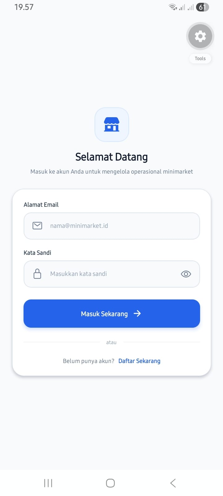
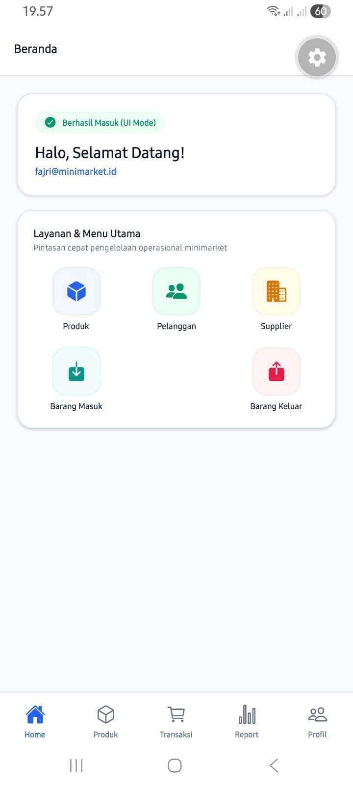
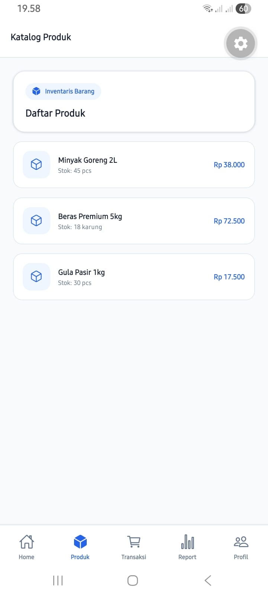
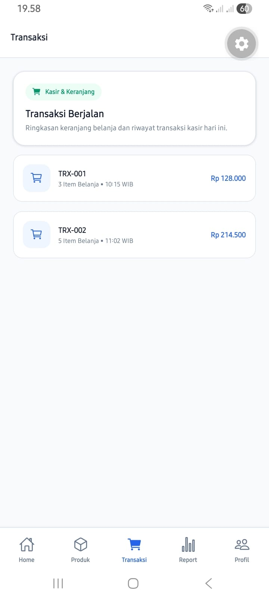
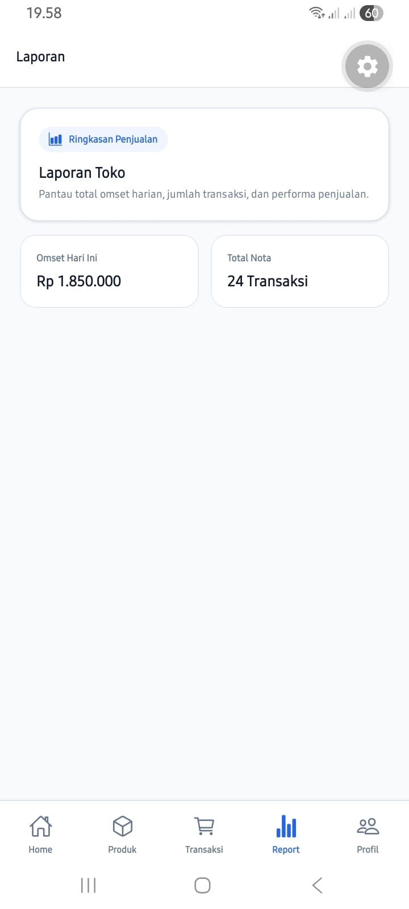
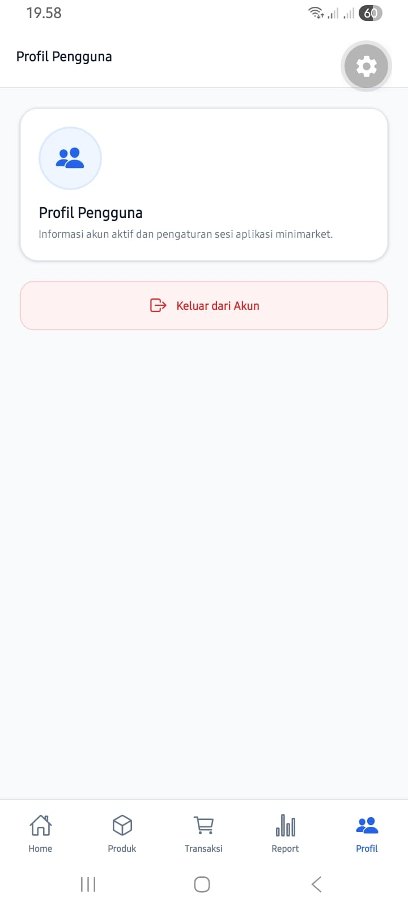

# Screenshot Hasil Aplikasi

Folder ini menampung bukti tangkapan layar aplikasi **minimarket** yang sudah berjalan
(Modul 10 — Bottom Navigation 5 Menu, Safe Area Insets, dan Dashboard Marketplace).

## Cara Mengisi

1. Jalankan aplikasi: `npx expo start`, lalu scan QR dengan Expo Go di HP.
2. Ambil screenshot pada perangkat (bukan emulator browser) untuk 6 layar berikut.
3. Simpan dengan nama file di bawah ini agar mudah diperiksa dosen.

## Hasil Screenshot

| Login | Home | Produk |
|---|---|---|
|  |  |  |

| Transaksi | Report | Profil |
|---|---|---|
|  |  |  |

## Daftar Screenshot yang Diminta Modul 10

| No | Nama File              | Layar yang Diambil                                        |
|----|------------------------|-----------------------------------------------------------|
| 1  | `01-login.png`         | Halaman Login modern                                      |
| 2  | `02-home.png`          | Tab Home (kartu sambutan + 5 menu cepat marketplace)      |
| 3  | `03-produk.png`        | Tab Produk (katalog barang)                               |
| 4  | `04-transaksi.png`     | Tab Transaksi (ikon cart)                                 |
| 5  | `05-report.png`        | Tab Report (statistik penjualan)                          |
| 6  | `06-profil.png`        | Tab Profil (ikon people + tombol Logout)                  |

## Poin yang Wajib Terlihat di Screenshot

- Layar Home: pastikan **tidak ada** tombol Logout (sudah dipindah ke Profil).
- Layar Home: kelima ikon menu cepat tampil sejajar (Produk, Pelanggan, Supplier,
  Barang Masuk, Barang Keluar).
- Layar Profil: tombol **Keluar dari Akun** terlihat.
- Semua layar bertab: bilah bawah tidak terpotong tombol navigasi HP
  (bukti `useSafeAreaInsets` bekerja).
