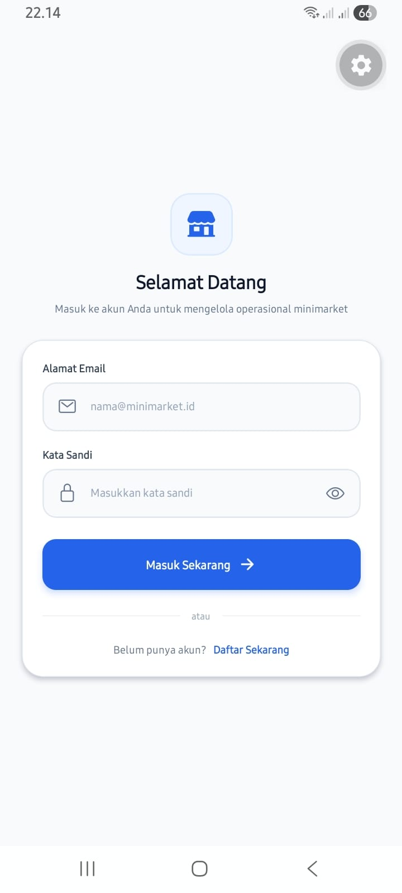
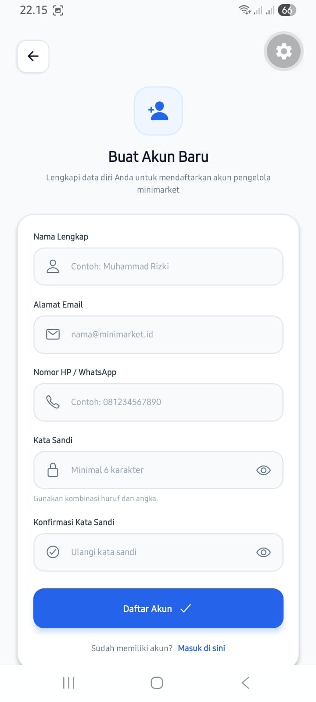
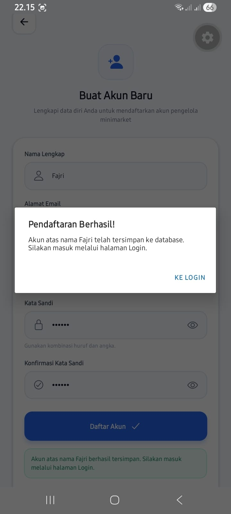
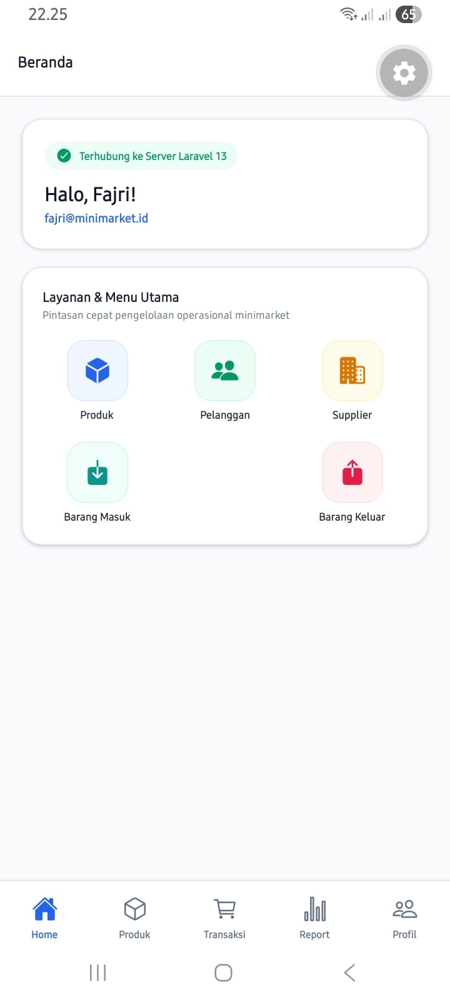
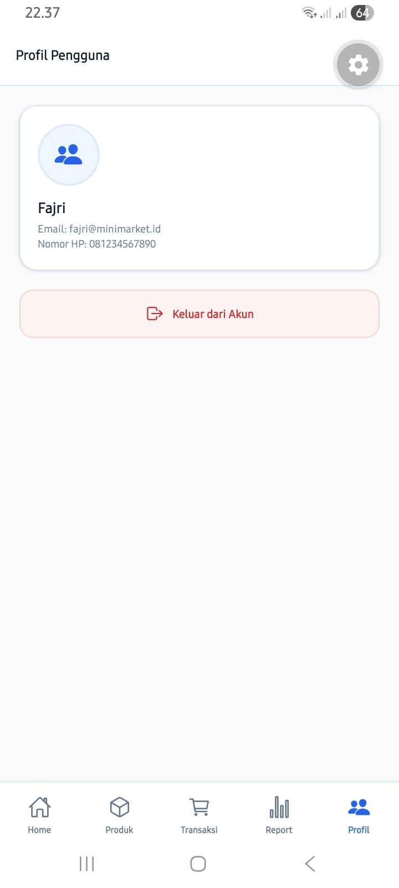
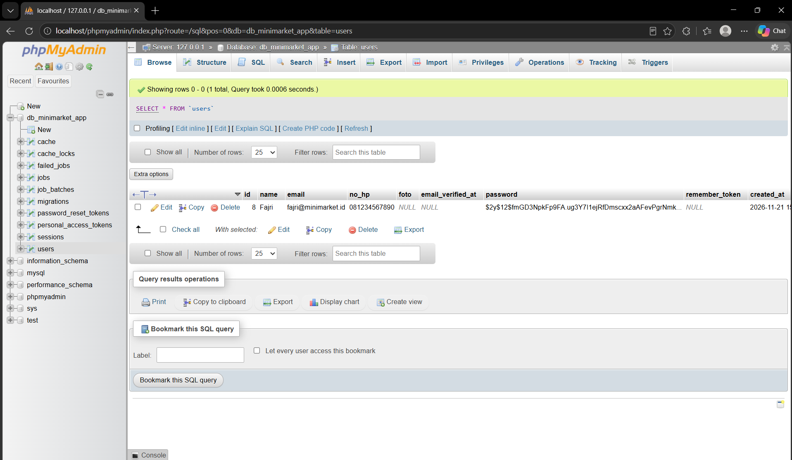
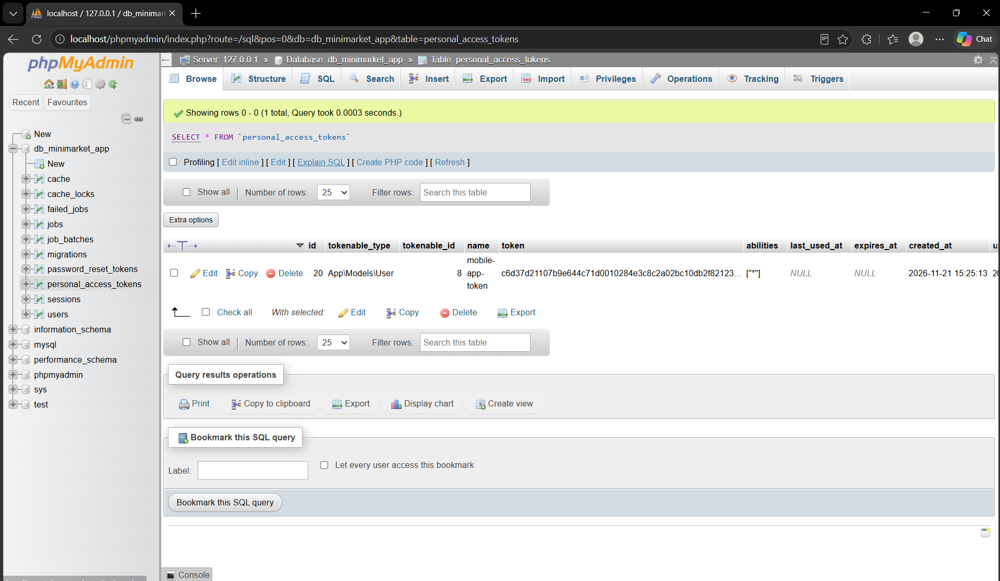

# Screenshot Hasil Aplikasi — Modul 11

Folder ini menampung bukti tangkapan layar aplikasi **minimarket** yang sudah berjalan
(Modul 11 — Instalasi Laravel 13, Sanctum API Token, dan Integrasi `fetch()`
Login & Register dengan `AsyncStorage`).

## Cara Mengisi

1. Nyalakan MySQL (Laragon/XAMPP), lalu jalankan backend Laravel:
   `php artisan serve --host=0.0.0.0 --port=8000`
2. Jalankan aplikasi: `npx expo start`, lalu scan QR dengan Expo Go di HP.
3. Pastikan HP dan laptop terhubung ke Wi-Fi yang sama, dan alamat IP pada
   `src/config/api.ts` sudah sama dengan hasil `ipconfig` di laptop.
4. Ambil screenshot langsung dari perangkat (bukan emulator browser).
5. Simpan dengan nama file di bawah ini agar mudah diperiksa dosen.

## Hasil Screenshot

| Login | Register | Register Berhasil |
|---|---|---|
|  |  |  |

| Home (Data Asli) | Profil (Data Asli) | Tabel `users` |
|---|---|---|
|  |  |  |

| Tabel `personal_access_tokens` | Setelah Logout |
|---|---|
|  |  |

## Daftar Screenshot yang Diminta Modul 11

| No | Nama File                    | Layar yang Diambil                                                     |
|----|------------------------------|------------------------------------------------------------------------|
| 1  | `01-login.png`               | Halaman Login dengan tombol **Masuk Sekarang**                          |
| 2  | `02-register.png`            | Halaman Register lengkap dengan input **Nomor HP / WhatsApp**           |
| 3  | `03-register-berhasil.png`   | Alert "Pendaftaran Berhasil!" setelah akun tersimpan ke MySQL           |
| 4  | `04-home-user.png`           | Tab Home menampilkan nama & email asli hasil login dari database         |
| 5  | `05-profil.png`              | Tab Profil menampilkan nama, email, Nomor HP, dan tombol Keluar          |
| 6  | `06-database-users.png`      | phpMyAdmin: tabel `users` berisi baris baru beserta `no_hp` yang terisi    |
| 7  | `07-token-sanctum.png`       | phpMyAdmin: tabel `personal_access_tokens` berisi token aktif             |
| 8  | `08-logout.png`              | Setelah logout, aplikasi kembali ke halaman Login                        |

## Poin yang Wajib Terlihat di Screenshot

- **Register**: kolom **Nomor HP / WhatsApp** tampil pada formulir pendaftaran.
- **Register berhasil**: muncul alert "Pendaftaran Berhasil!" yang menyebut nama akun
  sudah tersimpan ke database.
- **Home**: menampilkan nama dan email asli pengguna yang login, bukan teks statis.
  Badge "Terhubung ke Server Laravel 13" terlihat.
- **Profil**: nama, email, dan **Nomor HP** hasil login tampil, serta tombol
  **Keluar dari Akun** tersedia. Data harus **sama** dengan isi tabel `users`.
- **Database**: tabel `users` membuktikan akun benar-benar tersimpan di MySQL
  (kolom `no_hp` terisi, `password` ter-hash).
- **Token Sanctum**: tabel `personal_access_tokens` membuktikan token terbit saat login
  (`tokenable_type` = `App\Models\User`, `name` = `mobile-app-token`).
- **Logout**: aplikasi kembali ke halaman Login sebagai bukti sesi dihapus.

## Keterangan Alur

```
Register  -> POST /api/register  -> akun masuk tabel users + token terbit
Login     -> POST /api/login     -> token Sanctum disimpan di AsyncStorage
Home      -> getAuthSession()    -> nama & email dibaca dari AsyncStorage
Profil    -> getAuthSession()    -> nama, email, no_hp dibaca dari AsyncStorage
Logout    -> POST /api/logout    -> token dihapus di server, sesi lokal dibersihkan
```

## Backend

Aplikasi ini memanggil REST API Laravel 13 + Sanctum yang berada pada repo terpisah:

**https://github.com/Jri1810/Laravel-2110040-20261**

Jika alamat IP laptop berubah, cukup sesuaikan satu baris pada `src/config/api.ts`:

```ts
export const API_BASE_URL = "http://192.168.100.46:8000/api";
```
